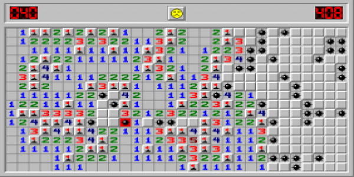

# Minesweeper

The classic Minesweeper game, built with vanilla JavaScript, HTML and CSS, without frameworks or libraries.

**[▶ Play the live demo](https://avraham186.github.io/mineSweeperVanila/)**

## Features

- Three difficulty levels: easy, medium and hard
- Lives system, so one wrong click doesn't end the game
- Right-click to flag suspected mines
- Recursive expansion of empty areas when an empty cell is clicked
- Stopwatch that starts on the first click
- Sound effects

## Tech

- Vanilla JavaScript (game state as a 2D matrix, DOM rendering)
- HTML5, CSS3

## Run locally

No build step: clone the repo and open `index.html` in a browser.
